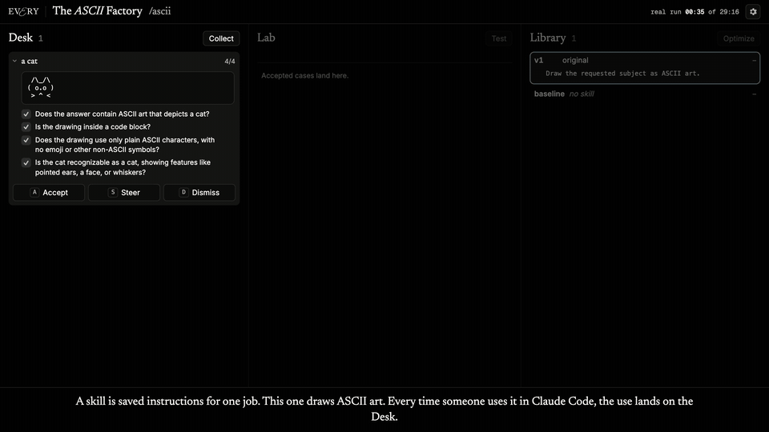

# The ASCII Factory

How a team's everyday corrections become a benchmark, and a benchmark becomes an AI skill that gets it right the first time. Made by [Every](https://every.to).

[](https://everyinc.github.io/ascii-factory/)

**[▶ Watch the two-minute video](https://everyinc.github.io/ascii-factory/)** · [Download the MP4](media/ascii-factory.mp4)

## What it shows

A skill is a set of saved instructions for one job. This one, `/ascii`, draws ASCII art. One person uses it in Claude Code and steers every drawing toward the same taste: solid, shaded, standing on a shadow. The board turns that into a skill that draws that way on its own:

1. **Steer.** Each use of the skill lands on the **Desk**. What the person says next in the session ("fill it in", "give it a shadow") becomes yes-or-no checks on that case.
2. **Accept.** An accepted case goes to the **Lab**. The cases and their checks are the benchmark, built from real work rather than made-up tests. A use not worth learning from is dismissed.
3. **Optimize.** In the **Library**, a teacher model writes a new version of the skill from the checks it fails.
4. **Test.** Every version runs on every case, first try, with no one steering. It replaces the skill only if it passes more checks than the current one. A version that loses never ships.

In the run in the video:

- Before the first optimization, each drawing took **2 corrections**. After it, **0**: the next drawings were right the first time.
- The skill went from **16 of 31** checks to **26**, then, with ten cases, to **46 of 50**.
- Of **13** versions tried, **5 won** and **8 lost**.

Every drawing, check and version in it was made by the models during a real 29-minute run, replayed about 20× faster.

## Run the board on your own skill

You need Node 20 or later and [Claude Code](https://claude.com/claude-code), logged in. Nothing to install: model calls go through your `claude` login.

```bash
node loop/v2/server.mjs
```

Open http://localhost:4488. To connect a skill, add this line to the frontmatter of its `SKILL.md` (the board shows it, with a Copy button):

```yaml
hooks: { Stop: [{ hooks: [{ type: command, command: "curl -s -m 2 -o /dev/null --json @- localhost:4488/catch || true" }] }] }
```

The `/ascii` skill in `.claude/skills/ascii` has the line already, and starts from one sentence of instructions. Open Claude Code in this folder, type `/ascii a cat`, steer the drawing, and accept or dismiss it on the Desk with `A` or `D`. Once a few cases are accepted, press **Optimize**.

**Settings** (the cog) say who does what: the **teacher** (Opus) writes versions, the **student** (Haiku) does the task on each case, and the **grader** (Sonnet) writes and answers the checks. Every action on the board is also a tool, over MCP for Claude Code:

```bash
claude mcp add --transport http toy-loop http://localhost:4488/mcp
```

The board only listens on localhost, because it rewrites a file Claude Code reads as instructions. It keeps its state in `data/v2.json`.

## License

[MIT](LICENSE). Made by [Every](https://every.to).
